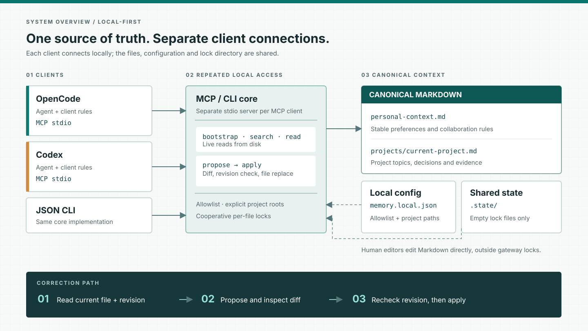

# Shared Memory Gateway

English | [简体中文](README.zh-CN.md)

**Personal and project context, shared across agents. Corrections instead of append-only memory.**

A small, local-first proof of concept for recording and maintaining personal and
project context across agent clients. The product is the local file-backed core
and its reusable Skill workflow; CLI is the execution interface and MCP is an
optional adapter. Markdown is the current portable, human-readable storage format,
not the product's purpose.
The core has no runtime dependencies, model calls, telemetry, or vector database.

[Agent rules](docs/AGENT_RULES.md) · [Security](SECURITY.md) · [Validation](docs/VALIDATION.md) · [Name and design](docs/DESIGN_REVIEW.md)

[Quick start](#quick-start) · [Architecture](#architecture) · [Skill workflow](#skill-workflow) · [CLI and MCP](#cli-and-mcp-integration) · [Roadmap](#roadmap--development-plan)

> **Alpha / proof of concept.** The caller performs semantic synthesis. This is
> not an autonomous memory extraction engine, a Mem0 replacement, or a certified
> concurrent editor. Start with a synthetic vault, not your production notes.

## Why another component?

Shared context has three separate problems:

1. **Access:** every client can reach the same approved notes.
2. **Lifecycle:** clients read them at the right time, including after compaction.
3. **Maintenance:** new knowledge corrects existing topics instead of accumulating
   mutually contradictory fragments.

The goal is to preserve useful personal preferences and project understanding
across tools and sessions, with clear boundaries between the two. Markdown is used
because people can inspect, edit, move, and version it with ordinary tools. A
portable Skill explains when and how the agent should use the local CLI. No agent
protocol by itself guarantees timely retrieval or factual quality.

## Architecture



Each agent uses the same local core and configured workspace. The Skill guides
the workflow; CLI actions execute reads and revision-checked writes. MCP stdio is
an optional adapter over the same core. All clients use the same local config,
Markdown files, and state directory; the state holds locks, not a second copy of
context. A human editor works on the files directly
and does not participate in the gateway lock. Project filtering selects relevant
content; it is **not** an access-control boundary. A client configured with this
workspace can read every allowlisted file.

### Context and responsibility

| Layer | Responsibility | Where it lives |
|---|---|---|
| Agent workflow | Decide when to load context, assess source and meaning, review diffs, enforce user policy | Shared `SKILL.md`; client skill loader |
| CLI / optional MCP | Execute local operations for agents | `cli.py`; optional `server.py` (`mcp` extra) |
| Shared core | Check allowlist, resolve an explicit project root, read/search current files, compare revisions and apply an exact edit | `core.py` |
| Canonical context | Separate personal and project topics, edited in place and portable as files | UTF-8 Markdown under configured `vault` |
| Machine-local metadata | List approved files, bootstrap entries, project mappings and coordinated locks | `memory.local.json` and `.state/`; not knowledge copies |

`init` creates `context/personal-context.md` and
`context/projects/current-project.md`. It bootstraps only the personal file;
when a registered root matches, `bootstrap(project_root)` returns the project's
file path in `entries`, which the agent then reads explicitly. Additional
topics require both an existing Markdown file and an explicit allowlist entry.
Neither a project match nor a search result proves a fact is true. The client
must keep personal preferences distinct from project claims and their evidence.

For larger workspaces, organize context by **personal preferences**, **collaboration
rules**, and **project knowledge**. Within project knowledge, link domain → system →
topic → evidence; keep dates, environments and verification status in the relevant
topic. These are authoring conventions, not a schema enforced by the core. The
starter puts collaboration rules in the personal template; split them into a
separate allowlisted file when useful. Obsidian is an optional editor, not a runtime
dependency.

### Read and correction paths

1. **Discover:** the Skill instructs the agent to call `bootstrap` through the CLI with its actual absolute project
   directory; the core returns a small global context and matching project
   paths, or an explicit unmatched/ambiguous status. `search` rereads allowlisted
   files and returns literal-match snippets; `read` returns the full selected file
   and its raw-byte SHA-256 revision.
2. **Propose:** for a stable, sourced correction, the client supplies the exact
   old and new passages, revision, reason and source. `propose_update` requires a
   unique old passage and returns a unified diff without writing anything.
3. **Apply:** after reviewing the diff under its own policy, the client calls
   `apply_update`. The core rechecks the revision under a cooperative file lock,
   writes a temporary file, checks for an external change and atomically replaces
   the file. A stale revision fails; the client must reread and reconcile.
   `forget` uses the same exact-passage update path and cannot erase Git history,
   backups or past model conversations.

Each core instance reads the same files; there is no central daemon. Atomic
replacement prevents partial file contents; the final external-edit check is
best effort. A failure after replacement can return `WRITE_UNCERTAIN`, so read
the file before deciding whether to retry.

This is a **file-first, local single-user design**, not an automatic fact
extractor or an agent runtime. A Skill guides tool use but does not guarantee
startup reads or compaction recovery. The lock coordinates gateway
processes only: direct editor writes can still race between the final check
and replacement. Recovery snapshots and better retrieval are [planned](#roadmap--development-plan),
not components of the diagram. See [validation](docs/VALIDATION.md) for tested
cross-client behavior and [security](SECURITY.md) for filesystem limits.

## Implemented

- `shared-memory init` creates separate personal and project context templates,
  an allowlisted workspace, and a machine-local config without overwriting files.
- `shared-memory demo` checks a disposable local correction; `setup --client skill`
  initializes a workspace and installs the portable Skill.
- `shared-memory agent` exposes argument-based bootstrap, read, search, propose,
  apply and forget actions for Skill workflows. `setup --client skill` safely
  reuses one workspace across non-overlapping projects.
- Exact allowlisted UTF-8 Markdown files; no recursive vault crawling.
- Raw-byte SHA-256 revisions, diff previews and exact single-passage replacements.
- Cross-process POSIX `flock`, atomic replacement and best-effort external-edit checks.
- Preservation of unrelated bytes / line endings and ordinary permission bits.
- Literal case-insensitive substring search, rereading disk every time; supports
  Chinese substrings without implying semantic retrieval or word segmentation.
- Explicit project-root mapping; unmatched/ambiguous projects are not guessed.
- Exact passage deletion, without keeping a second note history in service state.
- Optional MCP SDK adapter with six tools.
- Synthetic cross-agent model-session acceptance: OpenCode read `pending`; Codex
  read, previewed and applied `verified`; a fresh OpenCode session read `verified`
  through MCP (see [validation](docs/VALIDATION.md)).

## Not implemented

- Automatic fact extraction, truth checking, secret scanning, user approvals,
  embeddings, graph reasoning, background indexing or full conversation capture.
- Guaranteed lifecycle hooks, autonomous startup retrieval, project-switching and
  compaction recovery; Claude Code and WorkBuddy model sessions remain untested.
- A transactional protocol with arbitrary external editors, a multi-user security
  boundary, native Windows support, automatic context discovery, or full backup management.
- Durable idempotency receipts: replaying an applied proposal returns a revision
  conflict; reread before retrying an uncertain operation.

## Quick start

Python 3.11+ on macOS or Linux. Install from a checkout:

```bash
git clone https://github.com/boyceyuan/shared-memory-gateway.git
cd shared-memory-gateway
python3 -m venv .venv
.venv/bin/python -m pip install -e .
```

Still in this checkout, install the shared Skill and create its local context
workspace (replace the one absolute project path):

```bash
.venv/bin/shared-memory setup --client skill --directory "$HOME/.shared-memory-gateway" --project-root /absolute/path/to/your/project
```

`setup --client skill` creates the selected workspace (default
`~/.shared-memory-gateway/`) and installs `shared-context` under
`~/.agents/skills/`. Edit the printed personal/project note paths. Start a
**new** client session and ask it to use the `shared-context` skill. The Skill
then calls the CLI to bootstrap
the current project and read the matched note. Installing instructions is not
proof the client executed them; inspect the tool result. An unrelated existing
workspace or Skill is never overwritten.

To add another non-overlapping project, repeat the same command with its root.
This reuses the personal note, config and installed Skill, and creates a separate
project note. Running it again for the same root preserves existing notes.
The first project has ID `current-project`; later IDs use the root directory's
name. Duplicate names and overlapping roots require manual configuration.
Use `bootstrap.projects` and `bootstrap.entries`, rather than assuming an ID.

For an existing configured workspace, run
`.venv/bin/shared-memory skill install --workspace /absolute/path/to/workspace`.
`--skill-home /path/to/skills` selects another discovery source; the installer
adds `shared-context/SKILL.md` beneath it. The Skill binds absolute CLI/workspace
paths. Moving the installation requires reviewing/removing that generated Skill
and reinstalling it; a different existing Skill is rejected rather than updated.

### Optional MCP integration

If you specifically prefer MCP, install its extra and use the alternate setup
from the gateway checkout:

```bash
.venv/bin/python -m pip install -e '.[mcp]'
.venv/bin/shared-memory setup --client opencode --project-root /absolute/path/to/your/project
# or --client codex
```

MCP is an alternative transport, not a prerequisite for the Skill workflow.

Want a no-client self-check first? Run `.venv/bin/shared-memory demo`. It
prints `before: pending`, `after: verified`, and
`fresh_read: PASS` using disposable files. **This only checks the local core.**
The previous [Codex → OpenCode model-session test](docs/VALIDATION.md#real-client-model-sessions-cross-client-correction-passed)
used synthetic notes; startup retrieval without prompting remains unverified.

For manual setup, existing workspaces, migration, and protocol checks, see
[CLI and MCP integration](#cli-and-mcp-integration) and [validation](docs/VALIDATION.md).

## Skill workflow

The installed `shared-context` skill teaches compatible agents to:

- call `bootstrap` at task start with the current project path, then explicitly
  read matched project entries;
- use literal search when a topic is unknown and read its source before relying on it;
- preserve personal/project and evidence boundaries;
- preview revision-bound edits and apply them under the caller's approval policy,
  honoring standing authorization without repeatedly asking.

The skill is a workflow prompt, not a sandbox, model tool, or guarantee that a
client loads it. Its commands run through the local CLI. Verify actual skill
discovery and CLI calls in each client; loading the skill alone does not prove it
ran. Codex and OpenCode V2 documentation list the shared `~/.agents/skills`
location. Client/version evidence and any discovery limitations are recorded in
[validation](docs/VALIDATION.md#skill-first-validation-2026-10-28). Other agents
may require a different installation path.

## Context workspace configuration

See [`examples/memory.json`](examples/memory.json) or generate one with `init`.
Paths for `vault` and `state_dir` are relative to the config file; absolute paths
also work. `state_dir` must be outside the context directory and **identical for
all writers sharing that context**. It stores
empty lock files only. Keep configuration and the filesystem under trusted local
control; paths are not authorization for arbitrary machine access.

The starter workspace separates `personal-context.md` from
`projects/current-project.md`; project-specific contexts can be added and explicitly
allowlisted. `notes` is an explicit list of existing relative `.md` files, not a glob.
Symlinks are rejected. The server does not change frontmatter or impose a template.
Use a small bootstrap list to avoid injecting all context. Project roots are
absolute explicit paths; nested roots matching multiple projects are ambiguous.
Project filtering is retrieval convenience, not tenant-level authorization: every
client attached to a config can read every note allowlisted by that config.

## CLI and MCP integration

The Skill invokes the argument-based CLI. Every action requires an initialized
workspace, uses the configured allowlist, and reads live files:

```bash
shared-memory agent bootstrap --workspace "$HOME/.shared-memory-gateway" --project-root "$PWD"
shared-memory agent read --workspace "$HOME/.shared-memory-gateway" --note projects/current-project.md
shared-memory agent search --workspace "$HOME/.shared-memory-gateway" --query "decision" --project current-project
```

The read/search examples use the first project's generated paths; for other
projects use the entries and single project ID returned by bootstrap. Pass
`--project-root "$PWD"` to `bootstrap`; the command's default is the shell's
current directory. The CLI catches domain errors as structured JSON and reports
a nonzero exit status; scripts should check that status before consuming output.
For updates, `agent propose` prints a diff without writing; `agent apply` accepts
the same exact arguments and rechecks revision and passage under the file lock.
`agent forget` removes an exact passage. These are local operations; semantic
truth, privacy policy, and user approval remain the agent/user's responsibility.

MCP is an optional adapter over the same core. Install `.[mcp]` and use
`setup --client opencode` or `setup --client codex` to register it. The `init`
output still contains native OpenCode V2, Codex and generic `mcpServers` forms.

The initializer prints `opencode_v2_config`, `codex_mcp_add`, and `mcp_config`,
all using the active Python executable and absolute config path. For OpenCode V2,
merge this shape into your project or global `opencode.json(c)`:

```json
{
  "$schema": "https://opencode.ai/config.json",
  "mcp": {
    "servers": {
      "shared-memory-gateway": {
        "type": "local",
        "command": ["/absolute/path/to/python", "-m", "shared_memory_gateway.server", "--config", "/absolute/path/to/memory.local.json"]
      }
    }
  }
}
```

For Codex, execute the `codex_mcp_add` array as a command, or use this shape
with the paths printed by `init`:

```bash
codex mcp add shared-memory-gateway -- /absolute/path/to/python -m shared_memory_gateway.server --config /absolute/path/to/memory.local.json
```

The `mcp_config` output uses `mcpServers` for clients that support that shape.
The generated interpreter belongs to the environment where the package was
installed. If you move/recreate that environment, rerun `init` or update the
command. Client-specific configuration formats differ; add the suggested
[client rules](docs/AGENT_RULES.md) and verify actual tool use. The initializer
does not install an agent client or edit its configuration.

| Tool | Purpose |
|---|---|
| `bootstrap(project_root)` | Load configured global context and exact project entries |
| `search(query, project?, limit?)` | Literal search of current allowlisted files |
| `read(note)` | Return content and full raw-byte revision |
| `propose_update(note, expected_revision, old, new, reason, source)` | Preview one unambiguous replacement |
| `apply_update(proposal)` | Revalidate and apply the exact proposal |
| `forget(note, expected_revision, text, reason, source)` | Remove one exact passage |

The proposal digest binds request arguments. **It is not a signature, an approval,
or proof of truth.** Source / reason fields require nonempty strings, not verified
evidence. The caller must make and enforce semantic / privacy decisions. Source
and rationale are returned but not automatically persisted: put lasting evidence
in the topic's replacement text when appropriate.

## Name and design

The product name is under discussion; the published identifiers remain
`shared-memory-gateway`. The [design review](docs/DESIGN_REVIEW.md) compares
Basic Memory, MCP Memory Server, OpenLore, Mem0 and Letta by storage, update
behavior, scope and client integration. This README also draws on the
[Hindsight README](https://github.com/vectorize-io/hindsight#readme)'s separation
of concepts, operations and integrations, and
[OpenLore](https://github.com/aakarim/OpenLore#readme)'s explanation of read/write
ownership. The diagram above describes this repository's implementation.

## Roadmap / Development plan

The cross-client baseline below is complete. The remaining stages are
validation-gated plans, not delivery commitments.

### Completed baseline — Cross-client correction and read

- On isolated synthetic context, OpenCode and Codex model sessions called the
  MCP tools. Codex revised a prior status after reviewing the diff, and a new
  OpenCode session read the revised status. This verifies cross-client tool use
  and write visibility, **not** automatic lifecycle behavior; see
  [validation](docs/VALIDATION.md) for the exact scope and Codex approval policy.

### P0 — Validate client lifecycle and scope

- Test automatic retrieval at session start without an explicit tool-use prompt,
  project switching with distinct synthetic contexts, stale-write reconciliation
  by the model, and retrieval after compaction. Fresh-session reading with an
  explicit tool-use prompt is already covered by the baseline above.
- Verify Skill discovery and actual Skill-guided CLI execution separately; document
  client-specific setup and lifecycle hooks only where observed. MCP remains optional.
- Acceptance: record the actual tool calls and content for each scenario, including
  failures and unsupported hooks; do not use production context.

### P1 — Harden file updates

- Evaluate recovery snapshots / backups, crash recovery, stricter external-edit
  coordination, and filesystem metadata behavior.
- Add tests for each supported operating system and filesystem before expanding
  the support claim.
- Acceptance: interrupted writes have a documented recovery path; conflict and
  partial-failure outcomes remain explicit. Do not claim atomic coordination with
  arbitrary external editors without a protocol they participate in.

### P2 — Improve retrieval when evaluations justify it

- Build a small, source-annotated context evaluation set for Chinese, English, aliases,
  code identifiers, project isolation, stale facts, and no-answer queries.
- Compare current literal search with SQLite full-text search; consider semantic
  retrieval or reranking only if measured recall gaps justify the added runtime,
  model, and data-flow complexity.
- Acceptance: reproducible evaluation shows source-grounded retrieval improves
  without cross-project leakage or unacceptable latency / context growth.

### P3 — Optional synthesis integrations

- Explore Mem0 / Hindsight as candidate extraction or synthesis adapters, not as a
  second canonical store. Produce reviewable diffs against existing topics.
- Define provenance, user policy, correction, deletion, and outbound-data behavior
  before enabling any model-backed processing.
- Acceptance: corrections replace or qualify old claims; stale/conflicting facts
  are not silently accumulated or promoted to truth; deletion scope is explicit.

### Explicitly out of scope for the initial release

No hosted multi-user service, automatic full-conversation ingestion, graph database,
or autonomous memory rewriting is planned until a concrete need and security model
justify it. Contributions and issue reports can help reprioritize this roadmap.

## Concurrency boundaries

Two gateway processes using the same config/state coordinate with a per-note
lock and compare the expected revision *inside* that lock. A stale writer is
rejected rather than merged automatically. A proposal is not a write reservation.

External editors do not follow these locks. The final hash check catches many
external edits but leaves a check-to-replace race. Atomic rename prevents partial
file contents, not all lost updates from uncooperative editors. There are no
retained recovery snapshots yet: keep your own backups, and do not use this alpha
for concurrent edits of important notes. Cross-file changes are not transactions.
Filesystem metadata beyond ordinary permission bits (ACLs, xattrs, ownership,
hardlink identity) is not preserved or managed.

## Related systems

- [Basic Memory](https://github.com/basicmachines-co/basic-memory): a richer
  Markdown knowledge system. An optional isolated compatibility probe is included;
  it is not a dependency or certified backend.
- [Mem0](https://github.com/mem0ai/mem0): fact extraction and retrieval; check the
  current algorithm/version before assuming automatic update/delete behavior.
- [Hindsight](https://github.com/vectorize-io/hindsight): retain/recall/reflect and
  consolidated knowledge, with different canonical-store semantics.
- [Graphiti](https://github.com/getzep/graphiti): temporal context graphs.

No source code from these projects is bundled. Product benchmarks are not evidence
that this proof of concept works in real agent sessions.

## Contributing

See [CONTRIBUTING.md](CONTRIBUTING.md). Use synthetic fixtures only. Improvements
should preserve canonical file ownership and explicitly document concurrency,
privacy and evidence boundaries. MIT licensed.
