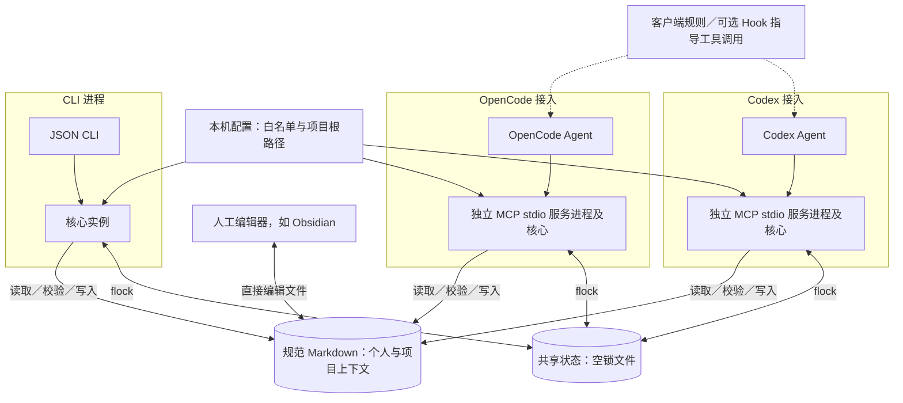
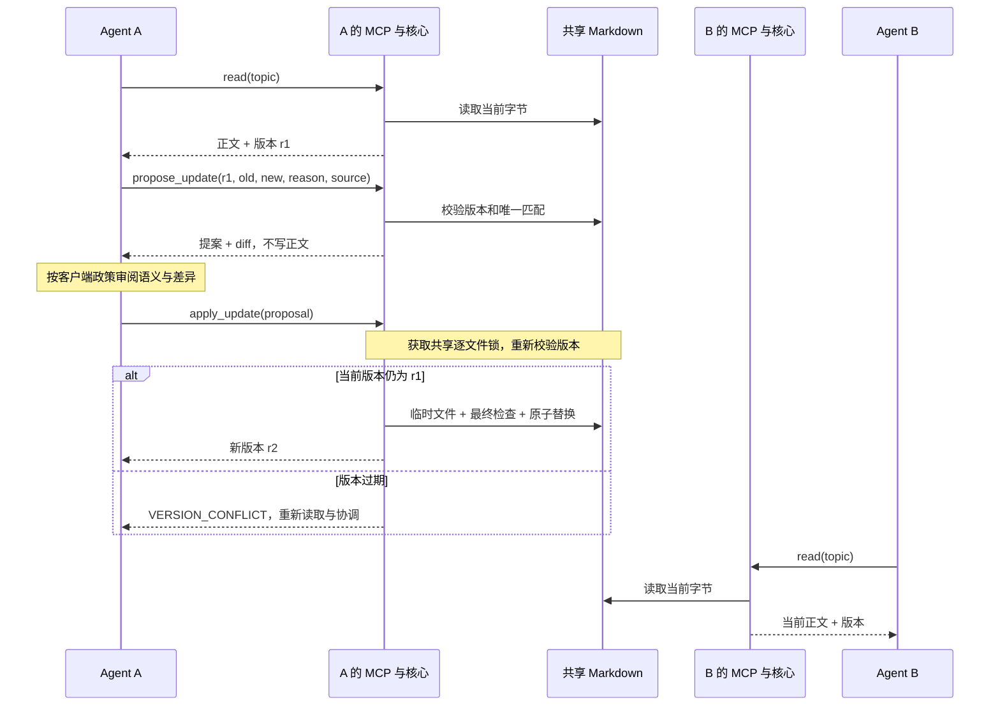

# Shared Memory Gateway

[English](README.md) | 简体中文

**记录个人与项目上下文，让多个 Agent 共用；修订旧记忆，而不只是不断追加。**

这是一个小型、本地优先的开源原型，用于记录和维护个人与项目上下文，并通过
CLI 或 MCP stdio 在多个 Agent 间共享。Markdown 是当前可迁移、可人工检查的
存储格式，不是项目目的本身。核心不调用模型、不发送遥测，也不要求向量数据库。

[Agent 使用规则](docs/AGENT_RULES.md) · [安全说明](SECURITY.md) · [验证记录](docs/VALIDATION.md) · [命名与设计](docs/DESIGN_REVIEW.zh-CN.md)

[快速开始](#快速开始) · [整体架构](#整体架构) · [上下文模型](#上下文与职责) · [MCP 接入](#mcp-接入) · [开发计划](#后续方向与开发计划)

> **Alpha／概念验证。** 语义理解与知识整合由调用方负责。本项目不是自动记忆
> 提取引擎、Mem0 替代品，也不是经过认证的并发编辑器。请先使用合成笔记库，
> 不要直接接入生产笔记。

## 为什么做这个项目

共享上下文有三个不同问题：

1. **共同访问**：每个客户端都能读取同一批获准笔记。
2. **及时读取**：在项目切换、上下文压缩等时机重新加载相关背景。
3. **持续维护**：新信息修订已有主题，而不是累积互相矛盾的片段。

项目目标是让个人偏好和项目理解能够跨工具、跨会话延续，同时明确区分个人与项目
边界。选择 Markdown 是因为用户可以直接查看、编辑、迁移和版本管理。MCP 提供
共同访问，但不保证客户端会及时读取，也不保证事实质量；本项目在其上提供精简的
写入边界和可复现测试。

## 整体架构



每个已接入的客户端各自启动 MCP stdio 进程，并持有独立核心实例；其他 MCP 客户端
也可接入同一适配器，但尚未验收。CLI 使用相同的
核心实现。各进程指向同一份本机配置、Markdown 文件与状态目录；状态目录
仅存锁，不维护第二套上下文。人工编辑器直接修改文件，不参与服务进程的锁。
项目过滤只决定返回哪些相关内容，**不是访问权限隔离**；接入同一工作区的客户端
可以读取全部白名单文件。

### 上下文与职责

| 层次 | 职责 | 位置 |
|---|---|---|
| Agent 客户端 | 决定读取时机、判断来源和语义、审阅差异、执行用户政策 | 客户端规则或 Hook；服务之外 |
| MCP／CLI 适配 | 为多个进程暴露同一套核心操作 | `server.py`（可选 `mcp` 依赖）、`cli.py` |
| 共享核心 | 校验白名单、匹配显式项目根路径、读盘检索、比较版本并应用精确修改 | `core.py` |
| 规范上下文 | 个人与项目主题分开维护，原位修订，文件可迁移 | 配置 `vault` 下的 UTF-8 Markdown |
| 本机元数据 | 记录批准文件、启动入口、项目映射和进程协调锁 | `memory.local.json` 与 `.state/`；不是知识副本 |

`init` 创建 `context/personal-context.md` 与
`context/projects/current-project.md`。启动时只直接返回个人文件；
`bootstrap(project_root)` 匹配注册项目后，会在 `entries` 中返回项目文件路径，
Agent 再按需显式读取。新增专题必须先有 Markdown 文件，再将其加入白名单。
项目匹配或检索命中不代表事实已证实；客户端应将个人偏好与项目结论及证据分开。

工作区扩大后，建议按**个人偏好、协作规则、项目知识**组织上下文。项目知识内部
按“领域 → 系统 → 专题 → 证据”链接，日期、环境与验证状态留在相关主题中。
这是内容组织约定，核心不强制校验这种结构。初始模板将协作规则放在个人文件中，
需要时可拆为独立的白名单文件。Obsidian 是可选编辑器，不是运行依赖。

### 读取与修订流程

1. **定位与读取：**客户端用当前实际项目的绝对路径调用 `bootstrap`，获得精简的
   全局上下文和项目入口，或明确的未匹配／歧义状态。`search` 每次读盘，返回字面
   命中的片段；`read` 返回指定文件全文和原始字节的 SHA-256 版本。
2. **预览修订：**客户端提供旧段、新段、预期版本、理由及来源；
   `propose_update` 要求旧段只出现一次，返回统一 diff，暂不写盘。
3. **检查并写入：**客户端按自己的政策检查 diff 后调用 `apply_update`。核心在
   协作文件锁内复查版本，写临时文件、尽力检查外部编辑，再原子替换。版本过期时
   必须重新读取并协调，不能盲目重试。`forget` 沿用精确段落更新流程，无法抹除
   Git 历史、备份或既往模型会话。



两个核心实例读取同一份文件，不存在中央常驻服务。原子替换避免
半写入正文，最终外部编辑检查属于尽力检测；替换后发生故障可能返回
`WRITE_UNCERTAIN`，应先读回文件，再决定如何重试。

这是**文件优先的本地单用户设计**，不是自动事实提取器或 Agent 运行时。MCP 只暴露
操作，不会自动触发启动读取或压缩恢复。锁仅协调 Gateway 进程；人工编辑仍可能在
最终检查与替换之间产生竞争。恢复快照和更强检索属于[后续计划](#后续方向与开发计划)，
不是架构图中的现有组件。已验证的跨客户端范围见[验证记录](docs/VALIDATION.md)，
文件系统边界见[安全说明](SECURITY.md)。

## 已实现

- 仅访问明确列入白名单的 UTF-8 Markdown 文件，不递归扫描整个笔记库。
- 使用原始字节 SHA-256 版本、修改预览和精确的单段替换。
- 使用 POSIX 跨进程 `flock`、原子替换，并尽力检测外部编辑。
- 保留无关内容、换行字节和普通文件权限位。
- 每次直接读取文件的大小写不敏感子串搜索，可搜索中文；不等同于语义检索
  或中文分词。
- 显式映射项目根目录；未匹配或有歧义时不猜测项目。
- 精确删除指定段落；服务状态中不保留第二份笔记历史。
- 可选 MCP SDK 适配器，暴露六个工具。
- 已在隔离合成库完成模型级交叉验证：Codex 通过 MCP 审阅差异并修订，新的 OpenCode
  会话读取到修订内容；证据与边界见[验证记录](docs/VALIDATION.md)。
- `shared-memory init` 可初始化独立的个人／项目上下文模板、白名单和本机配置，
  目标路径已存在时拒绝使用。

## 尚未实现

- 自动事实提取、事实核验、密钥扫描、用户审批、向量检索、图推理、后台索引，
  或完整对话采集。
- 保证自动启动读取、项目切换和压缩恢复；Claude Code 与 WorkBuddy 的模型会话仍未测试。
- 与任意外部编辑器协作的事务协议、多用户安全隔离、原生 Windows 支持、自动上下文
  发现或完整备份管理。
- 持久化幂等回执：重复应用已完成的修改会收到版本冲突；写入结果不确定时，
  应先重新读取再处理。

## 快速开始

macOS／Linux，Python 3.11+。先克隆项目：

```bash
git clone https://github.com/boyceyuan/shared-memory-gateway.git
cd shared-memory-gateway
python3 -m venv .venv
.venv/bin/python -m pip install -e '.[mcp]'
.venv/bin/shared-memory init --project-root /absolute/path/to/your/project
```

OpenCode V2 使用 `init` 输出的 `opencode_v2_config` 合并到 `opencode.json(c)`；
Codex 可执行输出的 `codex_mcp_add` 命令；其他支持 `mcpServers` 的客户端使用
`mcp_config`。重启客户端后，让它针对目标项目调用 `bootstrap`。下面的命令只验证
项目代码，不代表 Agent 应用已经接好。

```bash
.venv/bin/python -m unittest discover -s tests -v
.venv/bin/python scripts/verify_mcp.py
```

可选 `uv` 命令：`uv sync --extra mcp`，然后运行
`uv run python scripts/verify_mcp.py`。

初始化默认在 `~/.shared-memory-gateway/` 创建私有上下文工作区，并打印配置路径和
MCP 服务命令。可用 `--directory` 指定位置；目标路径已存在时会拒绝使用。检查生成的
个人／项目上下文模板后，选择对应客户端的配置。OpenCode V2 使用 `mcp.servers`，
仅修改 `mcpServers` 外层名称并不够：它还要求 `type: local` 和命令数组。
初始化器不会改写客户端设置。也可以在 Python 中
调用 `shared_memory_gateway.cli.initialize(...)` 获取结构化配置。
使用通用 `mcpServers` 配置结构的客户端可合并生成的条目。Agent 应用及运行时
依赖仍需单独安装。

创建不绑定具体项目路径的可迁移个人上下文工作区时，可省略 `--project-root`。
在不同机器间迁移时，先在目标机器用当地 checkout 路径初始化一个新的工作区，然后将
Markdown 上下文复制到新工作区的 `context/`；或者修改本机配置中的绝对项目根路径。
`memory.local.json` 与 `.state/` 是本机配置／状态，应忽略或在目标机器重新生成。
`init` 遇到已存在的目标路径会拒绝使用，迁移时不会覆盖既有上下文。项目根路径因机器而异，
在目标机器运行 `init --project-root` 注册当地 checkout。POSIX 初始化器会为工作区和上下文文件设置
仅当前用户可访问的权限；请将工作区放在你自己的备份范围内。`--project-root` 应指向
要加载项目上下文的目标项目，而不是本 Gateway 仓库；仅创建个人上下文时可省略。

读取项目自带的合成项目上下文：

```bash
echo '{"note":"demo.md"}' | .venv/bin/shared-memory read --config examples/memory.json
```

使用核心接口演示如何修订旧结论：

```python
from shared_memory_gateway.core import Memory

memory = Memory("examples/memory.json")
before = memory.read("demo.md")
proposal = memory.propose_update(
    note="demo.md", expected_revision=before["revision"],
    old="Status: pending", new="Status: verified",
    reason="替换旧状态，不再追加一个状态",
    source="合成验证",
)
print(proposal["diff"])       # 只预览，不修改笔记
memory.apply_update(proposal) # 仅在调用方政策允许时应用
```

该示例会修改项目自带文件。反复试验前请先将 `examples` 复制到临时目录。
自动化测试会自行创建并清理临时上下文工作区，不会触碰项目样例或个人数据。

## 上下文工作区配置

配置示例见 [`examples/memory.json`](examples/memory.json)，也可以通过 `init` 生成。
`vault` 和 `state_dir` 默认相对配置文件解析，也可以使用绝对路径。`state_dir`
必须位于上下文目录外，并且**所有共享该上下文的写入进程必须使用同一个目录**。其中只保存
空锁文件。请确保配置与文件系统位于可信的本机控制范围内。

初始工作区将 `personal-context.md` 与 `projects/current-project.md` 分开；新增
项目上下文文件后需显式加入白名单。`notes` 必须逐个列出已存在的相对 `.md` 文件，
不支持 glob；拒绝符号链接。服务不会自动修改 frontmatter 或强制文件模板。请用小型
`bootstrap` 列表，避免把全部上下文注入请求。项目根路径必须显式使用绝对路径；嵌套路径匹配多个项目时会
返回歧义。项目过滤只是检索范围，不是租户级授权：使用同一配置的客户端都能读取
该配置白名单中的全部笔记。

## MCP 接入

`init` 输出 `opencode_v2_config`、`codex_mcp_add` 和 `mcp_config`，都包含当前
Python 环境和配置文件的绝对路径。OpenCode V2 可将以下结构合并到项目或全局的
`opencode.json(c)`：

```json
{
  "$schema": "https://opencode.ai/config.json",
  "mcp": {
    "servers": {
      "shared-memory-gateway": {
        "type": "local",
        "command": ["/absolute/path/to/python", "-m", "shared_memory_gateway.server", "--config", "/absolute/path/to/memory.local.json"]
      }
    }
  }
}
```

Codex 可以直接执行 `codex_mcp_add` 数组对应的命令，形式如下（路径以 `init` 输出为准）：

```bash
codex mcp add shared-memory-gateway -- /absolute/path/to/python -m shared_memory_gateway.server --config /absolute/path/to/memory.local.json
```

`mcp_config` 使用适用于部分客户端的 `mcpServers` 格式。
该 Python 解释器属于安装此包的环境；移动或重建环境后需重新运行 `init` 或更新路径。
各客户端的 MCP 配置格式仍可能不同。请添加建议的[客户端规则](docs/AGENT_RULES.md)，
并验证模型实际调用工具；显示“已连接”不代表模型会及时读取上下文。初始化器不会安装
Agent 应用或修改客户端配置。

| 工具 | 作用 |
|---|---|
| `bootstrap(project_root)` | 加载启动上下文与项目入口 |
| `search(query, project?, limit?)` | 在白名单文件中实时子串搜索 |
| `read(note)` | 返回正文和完整原始字节版本 |
| `propose_update(note, expected_revision, old, new, reason, source)` | 预览一处无歧义的替换 |
| `apply_update(proposal)` | 重新校验并应用原提案 |
| `forget(note, expected_revision, text, reason, source)` | 删除一段精确匹配的正文 |

提案摘要只绑定请求参数，**不是数字签名、用户批准或事实属实的证明**。来源和
理由字段只检查非空，不验证证据。语义与隐私决策仍由调用方负责。来源与理由会在
结果中返回，但不会自动另存；需要长期保留的依据应在合适时整合进替换正文。

## 命名与设计

产品名仍在讨论中，已发布的技术标识保持 `shared-memory-gateway`。
[设计对照](docs/DESIGN_REVIEW.zh-CN.md) 按存储、更新、作用域和客户端接入比较
Basic Memory、MCP Memory Server、OpenLore、Mem0 和 Letta。本 README 的组织还
参考了 [Hindsight README](https://github.com/vectorize-io/hindsight#readme) 对概念、
操作与接入的分层说明，以及 [OpenLore](https://github.com/aakarim/OpenLore#readme)
对读写归属的解释；上方图表描述的是本仓库的实际实现。

## 后续方向与开发计划

这是一个**按验证结果推进的建议路线图**，不是交付承诺。功能只有在实现、测试，
并同步更新上方状态后，才算完成。

### P0：验证真实客户端工作流

- 在已完成的 Codex → OpenCode 模型会话修订与读取测试基础上，继续验证未提示时的
  启动读取、项目切换、模型处理旧版本冲突，以及上下文压缩后的恢复。
- 逐个验证客户端的 MCP 配置与生命周期 Hook 后，再编写对应接入说明。
- 验收标准：跨客户端读取与修订有效；明确记录不支持的 Hook 和模型级限制；不使用
  生产笔记库做测试。

### P1：加强文件更新可靠性

- 评估恢复快照／备份、进程异常后的恢复、更严格的外部编辑协调，以及文件系统元数据
  的处理方式。
- 在扩大系统支持范围前，为每个声明支持的操作系统和文件系统增加相应测试。
- 验收标准：中断写入有明确恢复路径；冲突与部分失败会明确报告。若外部编辑器不参与
  协议，不宣称能够与其实现严格原子协调。

### P2：根据评测改进检索

- 建立一组带规范来源的中英文上下文评测问题，覆盖别名、代码标识、项目隔离、过期事实和
  无答案查询。
- 将当前子串搜索与 SQLite 全文检索进行比较；只有评测显示召回不足时，才考虑语义检索
  或重排，并衡量新增运行时、模型依赖和数据流复杂度。
- 验收标准：结果可复现地提升来源支持的召回，且没有跨项目泄漏，延迟与上下文增长
  在可接受范围内。

### P3：可选的知识整合适配器

- 探索 Mem0／Hindsight 作为候选事实提取或归纳适配器，不建立第二份规范知识库；输出
  可审阅的主题修改差异。
- 启用任何模型处理前，先定义来源、用户维护规则、纠错、删除和对外发送的数据范围。
- 验收标准：纠正能够替换旧结论或明确限定其范围；冲突与过期事实不会被静默累积或
  升格为事实；删除影响范围清楚。

### 初期明确不做

在没有明确需求与安全模型前，不计划提供托管多用户服务、全量对话自动导入、图数据库，
或自主重写长期记忆。可根据实际使用与验证结果调整优先级。

## 并发边界

使用相同配置和状态目录的 Gateway 进程通过逐笔记锁协调，并在锁内校验预期版本。
旧版本写入会被拒绝，不会自动合并。生成提案并不等于预留了写入权。

外部编辑器不会遵守这些锁。最后的版本检查可以发现许多外部修改，但检查与替换
之间仍有竞争窗口。原子重命名可以避免半写入文件，不能避免所有非协作编辑造成的
覆盖。目前不保留恢复快照，请自行备份；不要将此 Alpha 用于重要笔记的并发编辑。
跨文件修改也不是事务。ACL、扩展属性、所有者和硬链接身份均不由本工具管理。

## 相关项目

- [Basic Memory](https://github.com/basicmachines-co/basic-memory)：功能更完整的
  Markdown 知识管理系统。本项目包含隔离兼容性探测脚本，但不依赖它，也没有将其
  认证为兼容后端。
- [Mem0](https://github.com/mem0ai/mem0)：事实提取与检索；不要在未核实当前算法
  版本前假定它会自动更新或删除旧事实。
- [Hindsight](https://github.com/vectorize-io/hindsight)：通过 retain／recall／
  reflect 处理记忆并形成整合知识，其规范存储语义与本项目不同。
- [Graphiti](https://github.com/getzep/graphiti)：时序上下文图。

本项目不包含上述项目的源代码。它们公开的基准成绩也不能证明本原型已在真实
Agent 会话中有效。

## 参与贡献

请先阅读[贡献指南](CONTRIBUTING.md)，仅使用合成测试数据。改进应保持规范文件的
唯一权威地位，并明确记录并发、隐私和证据边界。本项目采用 MIT 许可证。
