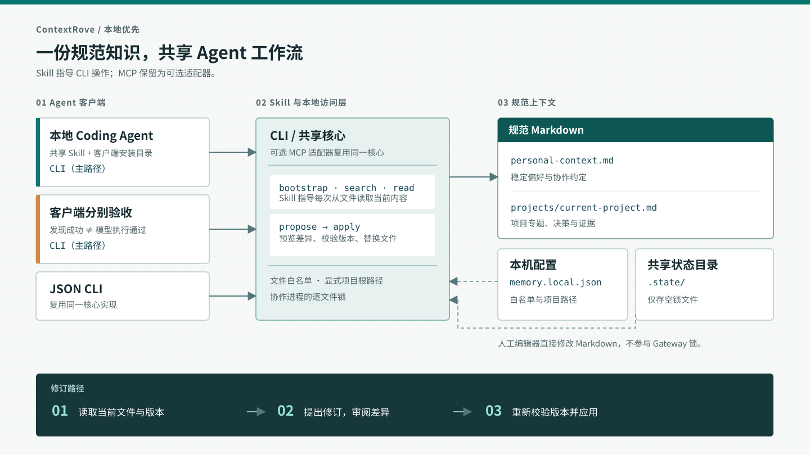

# ContextRove

[English](README.md) | 简体中文

**记录个人与项目上下文，让多个 Agent 共用；修订旧记忆，而不只是不断追加。**

这是一个小型、本地优先的开源原型，用于跨 Agent 维护个人与项目上下文。产品核心是
本地文件读写能力和可复用 Skill 工作流；CLI 负责执行，MCP 是可选适配器。Markdown
是当前可迁移、可人工检查的存储格式，不是项目目的本身。核心不调用模型、不发送遥测，
也不要求向量数据库。

原名 Shared Memory Gateway。ContextRove 表达上下文随你跨工具延续，工作方法和业务
SOP 逐步积累为可复用 Skill；当前包交付共享上下文维护及其内置 Skill 工作流。

[Agent 使用规则](docs/AGENT_RULES.md) · [安全说明](SECURITY.md) · [验证记录](docs/VALIDATION.md) · [命名与设计](docs/DESIGN_REVIEW.zh-CN.md)

[客户端兼容与安装路径](docs/CLIENTS.md) · [工作方法与业务 SOP](#从上下文到可复用工作方法)

[快速开始](#快速开始) · [整体架构](#整体架构) · [Skill 工作流](#skill-工作流) · [CLI 与 MCP](#cli-与-mcp-接入) · [开发计划](#后续方向与开发计划)

> **Alpha／概念验证。** 语义理解与知识整合由调用方负责。本项目不是自动记忆
> 提取引擎、Mem0 替代品，也不是经过认证的并发编辑器。请先使用合成笔记库，
> 不要直接接入生产笔记。

## 为什么做这个项目

共享上下文有三个不同问题：

1. **共同访问**：每个客户端都能读取同一批获准笔记。
2. **及时读取**：在项目切换、上下文压缩等时机重新加载相关背景。
3. **持续维护**：新信息修订已有主题，而不是累积互相矛盾的片段。

项目目标是让个人偏好和项目理解能够跨工具、跨会话延续，同时明确区分个人与项目
边界。选择 Markdown 是因为用户可以直接查看、编辑、迁移和版本管理。共享 Skill
说明何时读取以及如何谨慎修订；任何接入协议本身都不保证客户端会及时读取或事实质量。

## 整体架构



各 Agent 使用相同的本地核心与上下文工作区。Skill 指导工作流，CLI 执行读取和版本校验
后的写入；MCP stdio 是同一核心的可选适配器。各客户端使用同一份本机配置、Markdown
文件与状态目录；状态目录
仅存锁，不维护第二套上下文。人工编辑器直接修改文件，不参与服务进程的锁。
项目过滤只决定返回哪些相关内容，**不是访问权限隔离**；接入同一工作区的客户端
可以读取全部白名单文件。

### 上下文与职责

| 层次 | 职责 | 位置 |
|---|---|---|
| Agent 工作流 | 决定读取时机、判断来源和语义、审阅差异、执行用户政策 | 共享 `SKILL.md`；客户端 Skill 加载器 |
| CLI／可选 MCP | 为 Agent 执行本地上下文操作 | `cli.py`；可选 `server.py`（`mcp` 依赖） |
| 共享核心 | 校验白名单、匹配显式项目根路径、读盘检索、比较版本并应用精确修改 | `core.py` |
| 规范上下文 | 个人与项目主题分开维护，原位修订，文件可迁移 | 配置 `vault` 下的 UTF-8 Markdown |
| 本机元数据 | 记录批准文件、启动入口、项目映射和进程协调锁 | `memory.local.json` 与 `.state/`；不是知识副本 |

`init` 创建 `context/personal-context.md` 与
`context/projects/current-project.md`。启动时只直接返回个人文件；
`bootstrap(project_root)` 匹配注册项目后，会在 `entries` 中返回项目文件路径，
Agent 再按需显式读取。新增专题必须先有 Markdown 文件，再将其加入白名单。
项目匹配或检索命中不代表事实已证实；客户端应将个人偏好与项目结论及证据分开。

工作区扩大后，建议按**个人偏好、协作规则、项目知识**组织上下文。项目知识内部
按“领域 → 系统 → 专题 → 证据”链接，日期、环境与验证状态留在相关主题中。
这是内容组织约定，核心不强制校验这种结构。初始模板将协作规则放在个人文件中，
需要时可拆为独立的白名单文件。Obsidian 是可选编辑器，不是运行依赖。

### 读取与修订流程

1. **定位与读取：**Skill 指导 Agent 通过 CLI 用当前实际项目的绝对路径调用 `bootstrap`，获得精简的
   全局上下文和项目入口，或明确的未匹配／歧义状态。`search` 每次读盘，返回字面
   命中的片段；`read` 返回指定文件全文和原始字节的 SHA-256 版本。
2. **预览修订：**客户端提供旧段、新段、预期版本、理由及来源；
   `propose_update` 要求旧段只出现一次，返回统一 diff，暂不写盘。
3. **检查并写入：**客户端按自己的政策检查 diff 后调用 `apply_update`。核心在
   协作文件锁内复查版本，写临时文件、尽力检查外部编辑，再原子替换。版本过期时
   必须重新读取并协调，不能盲目重试。`forget` 沿用精确段落更新流程，无法抹除
   Git 历史、备份或既往模型会话。

各核心实例读取同一份文件，不存在中央常驻服务。原子替换避免
半写入正文，最终外部编辑检查属于尽力检测；替换后发生故障可能返回
`WRITE_UNCERTAIN`，应先读回文件，再决定如何重试。

这是**文件优先的本地单用户设计**，不是自动事实提取器或 Agent 运行时。Skill 只指导
工作流，不保证启动读取或压缩恢复。锁仅协调 Gateway 进程；人工编辑仍可能在
最终检查与替换之间产生竞争。恢复快照和更强检索属于[后续计划](#后续方向与开发计划)，
不是架构图中的现有组件。已验证的跨客户端范围见[验证记录](docs/VALIDATION.md)，
文件系统边界见[安全说明](SECURITY.md)。

## 已实现

- 仅访问明确列入白名单的 UTF-8 Markdown 文件，不递归扫描整个笔记库。
- 使用原始字节 SHA-256 版本、修改预览和精确的单段替换。
- 使用 POSIX 跨进程 `flock`、原子替换，并尽力检测外部编辑。
- 保留无关内容、换行字节和普通文件权限位。
- 每次直接读取文件的大小写不敏感子串搜索，可搜索中文；不等同于语义检索
  或中文分词。
- 显式映射项目根目录；未匹配或有歧义时不猜测项目。
- 精确删除指定段落；服务状态中不保留第二份笔记历史。
- 可选 MCP SDK 适配器，暴露六个工具。
- 已在隔离合成库完成模型级交叉验证：Codex 通过 MCP 审阅差异并修订，新的 OpenCode
  会话读取到修订内容；证据与边界见[验证记录](docs/VALIDATION.md)。
- `contextrove init` 可初始化独立的个人／项目上下文模板、白名单和本机配置，
  目标路径已存在时拒绝使用。
- `contextrove demo` 验证隔离的本地修订；`setup --client skill` 初始化工作区并安装
  便携 Skill。
- `contextrove agent` 提供面向 Skill 工作流的 bootstrap、read、search、propose、
  apply 与 forget 参数式命令。
- `setup --client skill` 可在不重叠的多个项目间安全复用同一工作区。
- 支持重复 `--agent` 的多客户端 Skill 安装、用户级／项目级作用域、冲突预检与只读
  `skill doctor`；具体边界见[兼容矩阵](docs/CLIENTS.md)。

## 尚未实现

- 自动事实提取、事实核验、密钥扫描、用户审批、向量检索、图推理、后台索引，
  或完整对话采集。
- 保证自动启动读取、项目切换和压缩恢复；Claude Code 与 WorkBuddy 的模型会话仍未测试。
- 与任意外部编辑器协作的事务协议、多用户安全隔离、原生 Windows 支持、自动上下文
  发现或完整备份管理。
- 持久化幂等回执：重复应用已完成的修改会收到版本冲突；写入结果不确定时，
  应先重新读取再处理。

## 快速开始

macOS／Linux，Python 3.11+。先在仓库目录安装：

```bash
git clone https://github.com/boyceyuan/contextrove.git
cd contextrove
python3 -m venv .venv
.venv/bin/python -m pip install -e .
```

仍在 Gateway 仓库目录，安装共享 Skill 并创建本地工作区（替换为项目绝对路径）：

```bash
.venv/bin/contextrove setup --client skill --agent codex --directory "$HOME/.shared-memory-gateway" --project-root /absolute/path/to/your/project
```

`setup --client skill` 会创建指定工作区（默认 `~/.shared-memory-gateway/`），并将
`shared-context` 安装到 Codex 的用户级 `~/.agents/skills/`。其他客户端从
[兼容矩阵](docs/CLIENTS.md) 选择 `--agent`；省略时仅适用于读取默认 `.agents/skills`
目录的客户端。编辑输出的个人／项目笔记路径，
启动一个**新**客户端会话，并要求它使用 `shared-context` Skill。Skill 会指导 Agent
通过 CLI 定位当前项目并读取匹配笔记。安装指令不代表客户端已执行；请检查实际工具输出。
已有工作区或 Skill 不会被覆盖。

接入另一个不重叠的项目时，用新项目根路径重复同一命令。个人笔记、配置和 Skill 会复用，
每个项目有独立笔记；相同根路径重复执行会保留已有内容。第一个项目 ID 为 `current-project`，
后续 ID 使用根目录名；重名或重叠根路径需要手动配置。以 `bootstrap.projects` 和
`bootstrap.entries` 返回值为准，不要假定项目 ID。

已有配置工作区可执行
`.venv/bin/contextrove skill install --workspace /absolute/path/to/workspace`。
`--skill-home /path/to/skills` 可指定其他发现目录，安装器会在其下创建 `shared-context/SKILL.md`。
Skill 绑定本机 CLI 与工作区的绝对路径；移动安装后，需要检查并移除原生成 Skill 再安装，
不同内容的已有 Skill 会被拒绝，不会自动更新。

### 为多个本地客户端安装

```bash
.venv/bin/contextrove skill clients
.venv/bin/contextrove skill install --workspace "$HOME/.shared-memory-gateway" --agent codex --agent claude-code --agent cursor
.venv/bin/contextrove skill doctor --workspace "$HOME/.shared-memory-gateway" --agent codex --agent claude-code --agent cursor
```

setup／install／doctor 加上 `--scope project --project-root /absolute/path/to/project`
可选择项目内的 Skill 目录。该选项决定安装位置，不限制只能访问该项目的笔记；各端使用
同一个工作区。重复选择会去重，相同发现路径会复用。`--skill-home` 仅能覆盖一个选定
客户端的 Skill 目录；WorkBuddy 必须显式提供这个路径。

setup 修改工作区前会检查所有已知目标冲突。安装时的 I/O 故障可能留下已完成目标或不完整
目录，`INSTALL_PARTIAL` 会给出失败路径。先运行 doctor、检查路径并保留用户修改，再重试。
doctor 只比较本地文件和检查基础配置是否存在，不启动客户端、不验证全部配置语义、
不代替客户端授予信任，也不证明模型已执行。

生成 Skill 含本机 CLI／工作区绝对路径，应在每台机器分别生成，避免提交到共享 Git 或
交给云端 Agent 使用。

### 可选 MCP 接入

如果明确需要 MCP，安装可选依赖后使用原有接入路径：

```bash
.venv/bin/python -m pip install -e '.[mcp]'
.venv/bin/contextrove setup --client opencode --project-root /absolute/path/to/your/project
# 或 --client codex
```

MCP 是另一种传输方式，不是 Skill 工作流的前置依赖。

想先做无需客户端的自检，可在仓库运行 `.venv/bin/contextrove demo`：
它用自动清理的合成文件输出 `before: pending`、`after: verified` 和
`fresh_read: PASS`，**仅验证本地核心**。
此前的 [Codex → OpenCode 模型会话验证](docs/VALIDATION.md#real-client-model-sessions-cross-client-correction-passed)
使用的是隔离合成笔记；无提示启动自动读取仍未验收。

手动 CLI／MCP 接入、已有工作区、迁移和协议测试见 [CLI 与 MCP 接入](#cli-与-mcp-接入)
及[验证记录](docs/VALIDATION.md)。

## Skill 工作流

安装的 `shared-context` Skill 会指导兼容 Agent：

- 在任务开始时用当前项目路径调用 `bootstrap`，再显式读取匹配的项目入口；
- 不确定主题时使用字面检索，并在依赖结果前读取来源正文；
- 区分个人偏好、项目事实与证据状态；
- 检查绑定版本的修订预览，并按调用方批准政策应用；已有持续授权时不重复询问。

Skill 是工作流指令，不是沙箱、本地工具或“客户端一定执行”的保证。命令由本机 CLI 执行。
应在各客户端分别核验 Skill 是否被发现、CLI 是否实际运行；仅加载 Skill 不等于执行了流程。
Codex 与 OpenCode V2 文档均列出共享 `~/.agents/skills` 目录；各版本的发现结果与限制见
[验证记录](docs/VALIDATION.md#skill-first-validation-2026-10-28)。其他 Agent 可能需要不同安装路径。

Codex CLI 0.165.0 的隔离 app-server Skill 列表发现测试通过。OpenCode CLI 2.2.0 的隔离 API
测试没有发现共享目录、文档所列原生全局目录或显式项目 Skill 源；这是本次 CLI/API 探针的
负向观察，不能据此断言 OpenCode TUI 不支持它们。OpenCode 的实际 Skill 引导执行仍待验证。

## 从上下文到可复用工作方法

长期目标还包括让工作判断与业务 SOP 能跨 Agent 延续。方法规范正文与领域知识一起维护，
说明输入、判断依据、取舍、例外、产物、验收标准和来源。Agent 可据此形成引用正文的
便携 Skill 草案，在真实任务和用户纠正中逐渐修订；候选方法、草案、已安装和客户端
实际执行通过分别标注。

当前安装器提供的是内置 `shared-context` 维护工作流，尚无自动习惯学习、业务 Skill
生成、任意 Skill 包分发或个人 Agent 训练功能。共享知识与工作流为后续积累提供基础，
方法提炼和各客户端行为验收仍需逐项推进；Skill 不扩大用户任务授权。

## 上下文工作区配置

配置示例见 [`examples/memory.json`](examples/memory.json)，也可以通过 `init` 生成。
`vault` 和 `state_dir` 默认相对配置文件解析，也可以使用绝对路径。`state_dir`
必须位于上下文目录外，并且**所有共享该上下文的写入进程必须使用同一个目录**。其中只保存
空锁文件。请确保配置与文件系统位于可信的本机控制范围内。

初始工作区将 `personal-context.md` 与 `projects/current-project.md` 分开；新增
项目上下文文件后需显式加入白名单。`notes` 必须逐个列出已存在的相对 `.md` 文件，
不支持 glob；拒绝符号链接。服务不会自动修改 frontmatter 或强制文件模板。请用小型
`bootstrap` 列表，避免把全部上下文注入请求。项目根路径必须显式使用绝对路径；嵌套路径匹配多个项目时会
返回歧义。项目过滤只是检索范围，不是租户级授权：使用同一配置的客户端都能读取
该配置白名单中的全部笔记。

## CLI 与 MCP 接入

Skill 通过参数式 CLI 调用本机核心。每个操作都要求已初始化的工作区，遵循文件白名单，
并直接读取当前文件：

```bash
contextrove agent bootstrap --workspace "$HOME/.shared-memory-gateway" --project-root "$PWD"
contextrove agent read --workspace "$HOME/.shared-memory-gateway" --note projects/current-project.md
contextrove agent search --workspace "$HOME/.shared-memory-gateway" --query "decision" --project current-project
```

上面的 read／search 示例使用第一个项目的生成路径；其他项目应使用 bootstrap 返回的入口与唯一项目 ID。
调用 `bootstrap` 时传入 `--project-root "$PWD"`；命令默认值就是 shell 当前目录。CLI 遇到领域错误时
会输出结构化 JSON 并返回非零状态码；脚本消费输出前应先检查状态码。
修订时，`agent propose` 只输出 diff、不写文件；`agent apply` 使用相同参数并在锁内重新
校验版本与精确段落。`agent forget` 删除精确段落。这些本地操作不负责验证语义真伪，隐私与
用户批准仍由 Agent／用户决定。

MCP 是同一核心的可选适配器。安装 `.[mcp]` 后可用 `setup --client opencode` 或
`setup --client codex` 注册。`init` 仍提供 OpenCode V2、Codex 和通用 `mcpServers` 配置。

`init` 输出 `opencode_v2_config`、`codex_mcp_add` 和 `mcp_config`，都包含当前
Python 环境和配置文件的绝对路径。OpenCode V2 可将以下结构合并到项目或全局的
`opencode.json(c)`：

```json
{
  "$schema": "https://opencode.ai/config.json",
  "mcp": {
    "servers": {
      "shared-memory-gateway": {
        "type": "local",
        "command": ["/absolute/path/to/python", "-m", "shared_memory_gateway.server", "--config", "/absolute/path/to/memory.local.json"]
      }
    }
  }
}
```

Codex 可以直接执行 `codex_mcp_add` 数组对应的命令，形式如下（路径以 `init` 输出为准）：

```bash
codex mcp add shared-memory-gateway -- /absolute/path/to/python -m shared_memory_gateway.server --config /absolute/path/to/memory.local.json
```

`mcp_config` 使用适用于部分客户端的 `mcpServers` 格式。
该 Python 解释器属于安装此包的环境；移动或重建环境后需重新运行 `init` 或更新路径。
各客户端的 MCP 配置格式仍可能不同。请添加建议的[客户端规则](docs/AGENT_RULES.md)，
并验证模型实际调用工具；显示“已连接”不代表模型会及时读取上下文。初始化器不会安装
Agent 应用或修改客户端配置。

| 工具 | 作用 |
|---|---|
| `bootstrap(project_root)` | 加载启动上下文与项目入口 |
| `search(query, project?, limit?)` | 在白名单文件中实时子串搜索 |
| `read(note)` | 返回正文和完整原始字节版本 |
| `propose_update(note, expected_revision, old, new, reason, source)` | 预览一处无歧义的替换 |
| `apply_update(proposal)` | 重新校验并应用原提案 |
| `forget(note, expected_revision, text, reason, source)` | 删除一段精确匹配的正文 |

提案摘要只绑定请求参数，**不是数字签名、用户批准或事实属实的证明**。来源和
理由字段只检查非空，不验证证据。语义与隐私决策仍由调用方负责。来源与理由会在
结果中返回，但不会自动另存；需要长期保留的依据应在合适时整合进替换正文。

## 命名与设计

产品与 Python 分发包更名为 **ContextRove**（`contextrove`）。保留旧命令
`shared-memory`／`shared-memory-mcp`、Python 模块 `shared_memory_gateway`、
MCP 服务 ID `shared-memory-gateway`、默认工作区 `~/.shared-memory-gateway` 和
Skill ID `shared-context` 以兼容已有配置。升级前参阅[迁移说明](docs/MIGRATION.md)。
[设计对照](docs/DESIGN_REVIEW.zh-CN.md) 按存储、更新、作用域和客户端接入比较
Basic Memory、MCP Memory Server、OpenLore、Mem0 和 Letta。本 README 的组织还
参考了 [Hindsight README](https://github.com/vectorize-io/hindsight#readme) 对概念、
操作与接入的分层说明，以及 [OpenLore](https://github.com/aakarim/OpenLore#readme)
对读写归属的解释；上方图示描述的是本仓库的实际实现。

## 后续方向与开发计划

下方跨客户端验证基线已完成；后续各阶段是按验证结果推进的计划，不是交付承诺。

### 已完成基线：跨客户端修订与读取

- 隔离合成库中，OpenCode 与 Codex 模型会话实际调用 MCP 工具；Codex 审阅差异并
  修订旧状态，全新 OpenCode 会话读取到新状态。这证明跨客户端工具调用与写入可见，
  **不证明**自动生命周期行为；具体范围和 Codex 审批条件见[验证记录](docs/VALIDATION.md)。

### P0：验证客户端生命周期与项目范围

- 分别测试无显式工具提示时的会话启动主动读取、不同合成项目之间的切换、模型处理
  旧版本冲突，以及压缩后的重新读取。新会话在明确提示调用工具后的读取已纳入上述
  验证基线。
- 仅在实际观察到支持后编写各客户端的 MCP 接入与生命周期 Hook 说明。
- 验收标准：逐项记录实际工具调用与读到的内容，包括失败和不支持的 Hook；
  不使用生产上下文。

### P1：加强文件更新可靠性

- 评估恢复快照／备份、进程异常后的恢复、更严格的外部编辑协调，以及文件系统元数据
  的处理方式。
- 在扩大系统支持范围前，为每个声明支持的操作系统和文件系统增加相应测试。
- 验收标准：中断写入有明确恢复路径；冲突与部分失败会明确报告。若外部编辑器不参与
  协议，不宣称能够与其实现严格原子协调。

### P2：根据评测改进检索

- 建立一组带规范来源的中英文上下文评测问题，覆盖别名、代码标识、项目隔离、过期事实和
  无答案查询。
- 将当前子串搜索与 SQLite 全文检索进行比较；只有评测显示召回不足时，才考虑语义检索
  或重排，并衡量新增运行时、模型依赖和数据流复杂度。
- 验收标准：结果可复现地提升来源支持的召回，且没有跨项目泄漏，延迟与上下文增长
  在可接受范围内。

### P3：可选的知识整合适配器

- 探索 Mem0／Hindsight 作为候选事实提取或归纳适配器，不建立第二份规范知识库；输出
  可审阅的主题修改差异。
- 启用任何模型处理前，先定义来源、用户维护规则、纠错、删除和对外发送的数据范围。
- 验收标准：纠正能够替换旧结论或明确限定其范围；冲突与过期事实不会被静默累积或
  升格为事实；删除影响范围清楚。

### 初期明确不做

在没有明确需求与安全模型前，不计划提供托管多用户服务、全量对话自动导入、图数据库，
或自主重写长期记忆。可根据实际使用与验证结果调整优先级。

## 并发边界

使用相同配置和状态目录的 Gateway 进程通过逐笔记锁协调，并在锁内校验预期版本。
旧版本写入会被拒绝，不会自动合并。生成提案并不等于预留了写入权。

外部编辑器不会遵守这些锁。最后的版本检查可以发现许多外部修改，但检查与替换
之间仍有竞争窗口。原子重命名可以避免半写入文件，不能避免所有非协作编辑造成的
覆盖。目前不保留恢复快照，请自行备份；不要将此 Alpha 用于重要笔记的并发编辑。
跨文件修改也不是事务。ACL、扩展属性、所有者和硬链接身份均不由本工具管理。

## 相关项目

- [Basic Memory](https://github.com/basicmachines-co/basic-memory)：功能更完整的
  Markdown 知识管理系统。本项目包含隔离兼容性探测脚本，但不依赖它，也没有将其
  认证为兼容后端。
- [Mem0](https://github.com/mem0ai/mem0)：事实提取与检索；不要在未核实当前算法
  版本前假定它会自动更新或删除旧事实。
- [Hindsight](https://github.com/vectorize-io/hindsight)：通过 retain／recall／
  reflect 处理记忆并形成整合知识，其规范存储语义与本项目不同。
- [Graphiti](https://github.com/getzep/graphiti)：时序上下文图。

本项目不包含上述项目的源代码。它们公开的基准成绩也不能证明本原型已在真实
Agent 会话中有效。

## 参与贡献

请先阅读[贡献指南](CONTRIBUTING.md)，仅使用合成测试数据。改进应保持规范文件的
唯一权威地位，并明确记录并发、隐私和证据边界。本项目采用 MIT 许可证。
